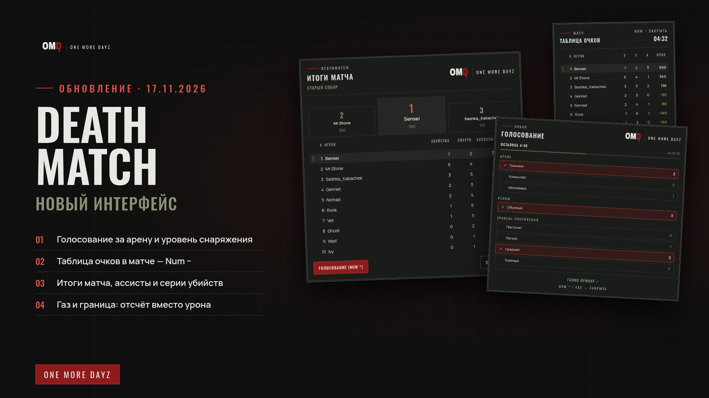

<p align="center">
  
</p>

<h1 align="center">OMD Deathmatch</h1>

<p align="center">
  A fast arena deathmatch mode for <b>DayZ</b> with arena voting, a live scoreboard, match results and a custom One More DayZ interface.
</p>

<p align="center">
  
  
  
  
</p>

> 🇷🇺 Русская версия — [ниже](#-по-русски).

## Features

- **Arena and loadout voting** (`Num *`). Players vote for the next arena and gear tier, counters update live, and votes count even after death. The `!arenavote` chat command works too.
- **Live scoreboard** (`Num -`). Place, kills, deaths, assists, score and time left in the match.
- **Match results** window with a top-3 podium and the full table.
- **Score system** that rewards aggressive and smart play (see below).
- **Gas and arena border** without health drain: leaving the zone starts a countdown instead, so deaths are always readable.
- **Fair spawns** spread across the whole arena, always inside the safe zone (at least 15 m from the gas edge).
- **Kill credit for bleed-outs, shock and cardiac arrest**: the last player who hit you within 60 s gets the kill.
- **Custom UI** in the One More DayZ style; menus toggle with the same key or `Esc` without trapping input.

## Score system

| Event | Points |
|---|---:|
| Kill | **+100** |
| Kill by bleeding, shock or cardiac arrest | **+75** |
| Assist (hit the target in the last 30 s) | **+40** |
| Every 3 kills in a row | **+50** |
| Killing the match leader | **+50** |
| Killed by a player | **−150** |
| Any other death | **−200** |

## Controls

| Key | Action |
|---|---|
| `Num *` | Open or close arena voting |
| `Num -` | Show the scoreboard |
| `Esc` | Close any OMD window |

Keys can be rebound in the game controls under the **OMD Deathmatch** group.

## Architecture

The mod is split into two parts:

- **Client (this repository, open source).** UI layouts, menus, HUD, input bindings and RPC receivers.
- **Server (private repository).** Match loop, arena selection, spawns, gas and border, scoring and loadouts.

The server is authoritative: it runs the match and sends match events, vote counts and scoreboard data to clients over RPC; the client only displays them and sends player input (votes) back.

```
OMD_Deathmatch/
├── Scripts/
│   ├── 3_Game/      # RPC ids, shared client game code
│   ├── 4_World/     # PlayerBase hooks, scoreboard data
│   └── 5_Mission/   # vote menu, scoreboard HUD and menu, results
├── gui/
│   ├── imagesets/   # OMD icons and lockup
│   └── layouts/     # .layout files for every window
├── inputs.xml       # Num * / Num - bindings
├── stringtable.csv  # localization
└── config.cpp
```

## Installation

1. Subscribe to the mod in Steam Workshop *(link coming soon)* or build the PBO from this folder.
2. Add the client mod to the server and client `-mod=` launch parameters.
3. The server part is required for matches to run; it is available on the One More DayZ server.

## Changelog

Release notes are published in [Releases](../../releases).

## Authors

- **Comrad-Sensei**
- **mmetrjuk**

Part of the **One More DayZ** project.

---

## 🇷🇺 По-русски

**OMD Deathmatch** — быстрый режим Deathmatch для DayZ: голосование за арену и уровень снаряжения (`Num *`), таблица очков во время матча (`Num -`), окно «Итоги матча» с пьедесталом топ-3, своя система очков и интерфейс в стиле One More DayZ.

Газ и граница арены не отнимают здоровье, а запускают отсчёт. Спавн всегда внутри безопасной зоны. Смерть от кровотечения, шока или остановки сердца засчитывается последнему, кто попал по игроку за 60 секунд.

Клиентская часть открыта (этот репозиторий), серверная закрыта. Система очков и управление — в таблицах выше.
